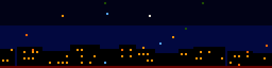
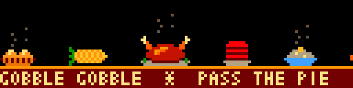
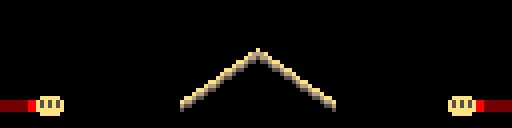

# thanksgiving

Applets for Thanksgiving week. They stay registered all year and set `isActive = false` outside their window, so the scheduler skips them. The week runs Monday through Sunday around the fourth Thursday of November, computed in `America/New_York` because the renderer runs in UTC. With `window: "day"`, an applet is active on Thanksgiving Day only.

Most art is original, drawn as palette-indexed text sprites in `lib/`. Colors are tuned for gamma 2.8 (see the note in `lib/palette.ts`), which is why the "browns" are rust and mahogany. The food and pumpkins are CC0 sprites; see [CC0 art](#cc0-art).

## What's scheduled

- **All week:** Turkey Trot has one slot in the rotation.
- **Thanksgiving Day:** `HolidayRotationApplet` is interleaved after every regular slot (`scheduler.interleave(...)`). It cycles through Parade Balloon, Falling Leaves (no words, with pumpkins), and Harvest Table.

Pie Countdown and Wishbone are built but not scheduled.

## Turkey Trot

A turkey struts in from the left and the greeting appears behind it as it passes. It stops, fans its tail, gobbles twice, and pecks at the stubble.


## Parade Balloon

A turkey balloon floats over a lit skyline, held by handlers on tethers, while confetti falls.



## Falling Leaves

Maple, oak, and elm leaves flutter down past a harvest moon and settle into a drift that builds along the bottom, piling onto pumpkins when `pumpkins` is on.


## Harvest Table

The dinner spread slides along a red tablecloth with wisps of steam rising, and a message is stitched into the cloth below. The dishes run one full lap per render.



## Pie Countdown

The pie is eaten one slice at a time as "8 SLICES LEFT" counts down, ending on an empty plate and "SECONDS?".


## Wishbone

"MAKE A WISH", then two hands tug a wishbone until it snaps, and the winning half gets sparkles and "WISH GRANTED!".



## Config Values

Every applet takes these:

| Key         | Type              | Description                                          | Default            |
| ----------- | ----------------- | ---------------------------------------------------- | ------------------ |
| `force`     | `boolean`         | Ignore the calendar and always show (previews)       | `false`            |
| `window`    | `"week" \| "day"` | Thanksgiving week, or Thanksgiving Day only          | `"week"`           |
| `timeZone`  | `string`          | IANA zone the dates are computed in                  | `America/New_York` |
| `frameRate` | `number`          | Frames per second                                    | 10–15              |

Applet-specific keys:

| Applet          | Key        | Type       | Default                                |
| --------------- | ---------- | ---------- | -------------------------------------- |
| TurkeyTrot      | `line1`    | `string`   | `"HAPPY"`                              |
| TurkeyTrot      | `line2`    | `string`   | `"THANKSGIVING"`                       |
| FallingLeaves   | `text`     | `string`   | `"GIVE THANKS"` (`""` for no words)    |
| FallingLeaves   | `pumpkins` | `boolean`  | `false`                                |
| FallingLeaves   | `duration` | `number`   | `15` (seconds)                         |
| HarvestTable    | `message`  | `string`   | `"GOBBLE GOBBLE * PASS THE PIE * ..."` |
| HarvestTable    | `menu`     | `Dish[]`   | `MENU` from `lib/food.ts`              |
| HolidayRotation | `applets`  | `Applet[]` | required                               |

The table message uses the 3×5 mono font, where `W` reads as `H`, so avoid words with W.

## CC0 art

| Folder                 | Source                                                                   | Used in                    |
| ---------------------- | ------------------------------------------------------------------------ | -------------------------- |
| `assets/henry-food`    | [Free Pixel Food](https://henrysoftware.itch.io/pixel-food), Henry Software | Harvest Table (`MENU`)     |
| `assets/kami-pumpkins` | [Pixel Pumpkins](https://kamioo.itch.io/pixel-pumpkins), Kami            | Falling Leaves (`pumpkins`) |

`scripts/import-sprites.js` converts those PNGs into `lib/henryFood.ts` and `lib/kamiPumpkins.ts`, lifting brightness so the dark shades survive gamma. Re-run it after adding a PNG:

```
NODE_PATH=../../node_modules node scripts/import-sprites.js
```

The default menu leaves out the drumstick and turnip (`EXTRA_DISHES`) to keep the table GIF near 260 KB. The original hand-drawn dishes are still available as `ORIGINAL_MENU`. Don't commit Netherzapdos' Pixel Platter: its license forbids redistribution.
