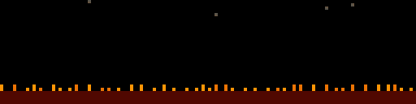
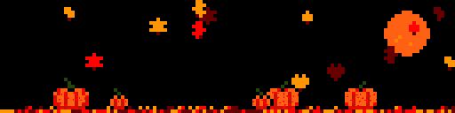

# thanksgiving

Three applets for Thanksgiving week. They stay registered all year and set `isActive = false` outside the week, so the scheduler skips them. The week runs Monday through Sunday around the fourth Thursday of November, computed in `America/New_York` because the renderer runs in UTC.

All art is original and drawn as palette-indexed text sprites in `lib/`. Colors are tuned for gamma 2.8 (see the note in `lib/palette.ts`), which is why the "browns" are rust and mahogany.

## Turkey Trot

A turkey struts in from the left and the greeting appears behind it as it passes. It stops, fans its tail, gobbles twice, and pecks at the stubble.

## Falling Leaves

Maple, oak, and elm leaves flutter down past a harvest moon and settle into a drift that builds along the bottom.

## Harvest Table

The dinner spread slides along a red tablecloth, steaming, with a message stitched into the cloth below. The dishes run one full lap per render.

## Config Values

Every applet takes these:

| Key         | Type      | Description                                      | Default            |
| ----------- | --------- | ------------------------------------------------ | ------------------ |
| `force`     | `boolean` | Ignore the calendar and always show (previews)   | `false`            |
| `timeZone`  | `string`  | IANA zone that Thanksgiving week is computed in  | `America/New_York` |
| `frameRate` | `number`  | Frames per second                                | 10 / 12 / 15       |

Applet-specific keys:

| Applet          | Key        | Type     | Default                                    |
| --------------- | ---------- | -------- | ------------------------------------------ |
| TurkeyTrot      | `line1`    | `string` | `"HAPPY"`                                  |
| TurkeyTrot      | `line2`    | `string` | `"THANKSGIVING"`                           |
| FallingLeaves   | `text`     | `string` | `"GIVE THANKS"`                            |
| FallingLeaves   | `duration` | `number` | `15` (seconds)                             |
| HarvestTable    | `message`  | `string` | `"GOBBLE GOBBLE * PASS THE PIE * ..."`     |
| HarvestTable    | `menu`     | `Dish[]` | `MENU` from `lib/food.ts`                  |

The table message uses the 3×5 mono font, where `W` reads as `H`, so avoid words with W.

## Swapping in CC0 food art

`lib/food.ts` exports each dish as `{ sprite, hot, steamFrom }`. To use Henry Software's [Free Pixel Food](https://henrysoftware.itch.io/pixel-food) (CC0), put `Food.png` in `assets/`, convert the cells you want into sprites (or into base64 PNGs drawn with `drawImage`), and replace the matching dish. Don't commit Netherzapdos' Pixel Platter: its license forbids redistribution.
